<h1>Finances</h1>

A self-hosted expense tracker for everyday spending, built as an installable web app in Material Design 3. Record an
expense in seconds, see where the month stands and what your fixed costs add up to, and let the app point out spending
habits you might not notice yourself. It works offline, in English and German, and keeps every user's data on your own
server.

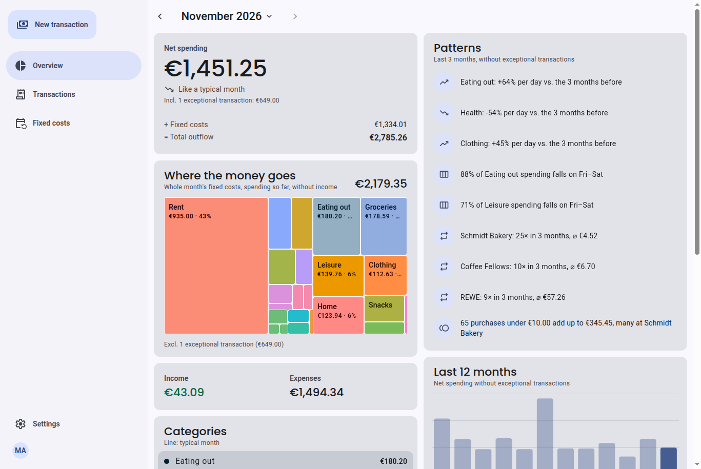

<h2>Contents</h2>

<!-- TOC -->

- [Features](#features)
    - [Monthly overview](#monthly-overview)
    - [Patterns](#patterns)
    - [Fast entry](#fast-entry)
    - [Transactions](#transactions)
    - [Fixed costs](#fixed-costs)
    - [Search](#search)
    - [Categories and settings](#categories-and-settings)
    - [Offline and installable](#offline-and-installable)
- [Self-hosting with Docker](#self-hosting-with-docker)
    - [Users](#users)
    - [Backup and restore](#backup-and-restore)
    - [Build from source](#build-from-source)
- [Configuration](#configuration)
- [Tech stack](#tech-stack)

<!-- TOC -->

## Features

The screenshots show a fictional account (see [`docs/screenshots`](docs/screenshots)).

### Monthly overview

The month at a glance: net spending so far and how it compares with a typical month by the same day, fixed costs on
top for the total outflow, and a treemap of where the money goes. Below are income and expenses, every category
against its typical month, and the last 12 months. Exceptional transactions such as a new washing machine still count
towards the month but stay out of the comparisons. Swipe or use the month picker to look back.

<p>
    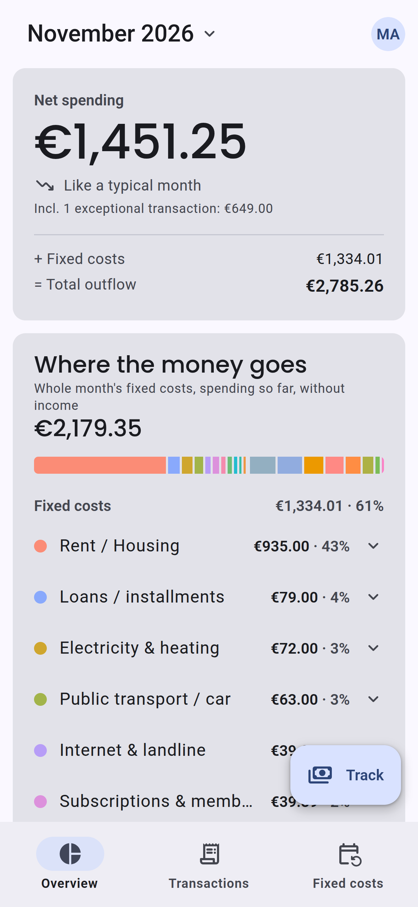
    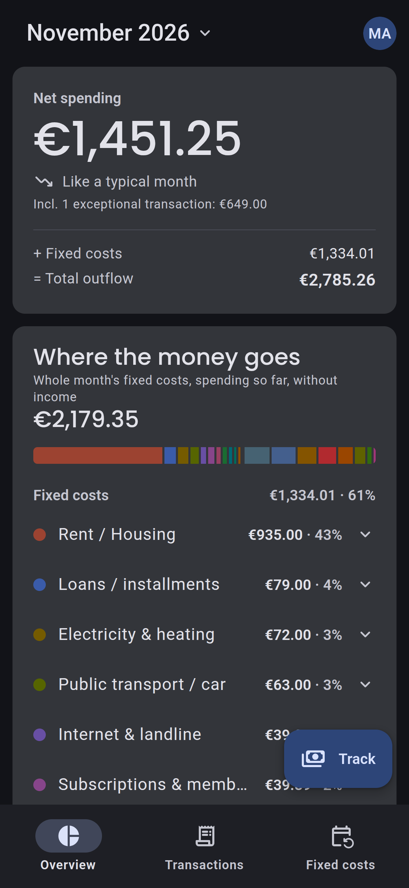
</p>

The theme follows the system setting. Further down the overview:

<p>
    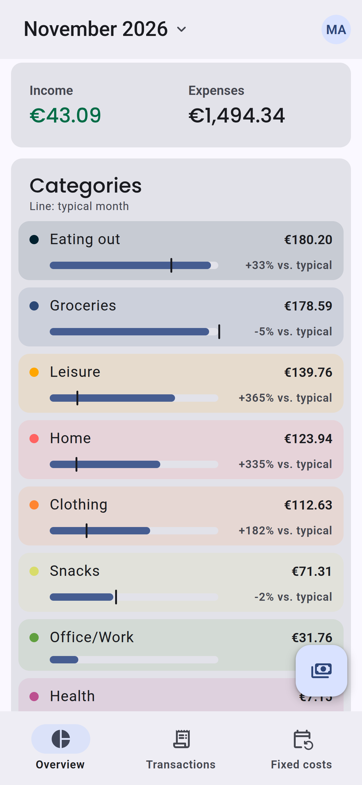
    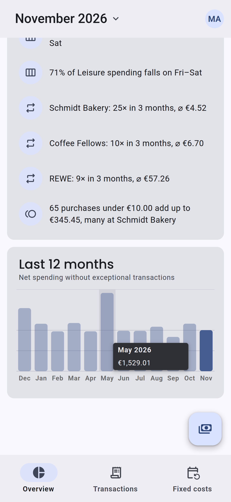
</p>

### Patterns

The app looks for regularities in the last three months that are easy to miss: a category that drifts up or down,
spending that clusters on certain weekdays, the same shop again and again, and many small purchases that add up.
Nothing to set up; the patterns come from your transactions alone.

<p>
    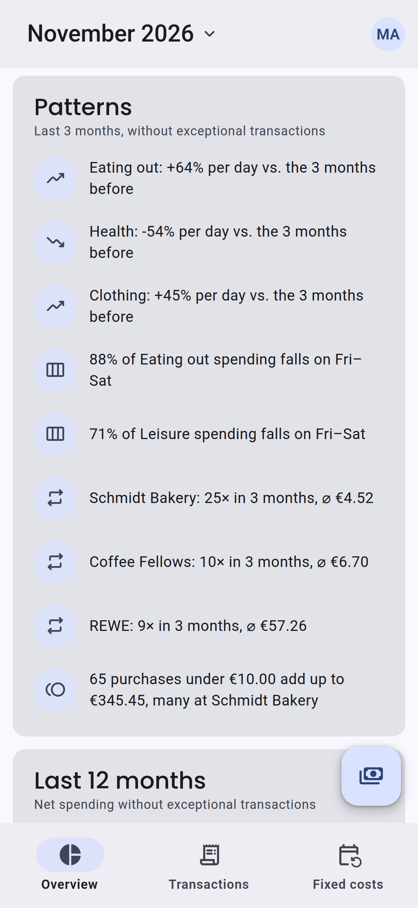
</p>

### Fast entry

Type the first letters of a shop and the app suggests it, together with its usual category and last amount. Chips
pick the category and the date in one tap. A restaurant bill can get its tip attached, an online order its shipping,
each with its own category, and the app shows what is left of the total.

<p>
    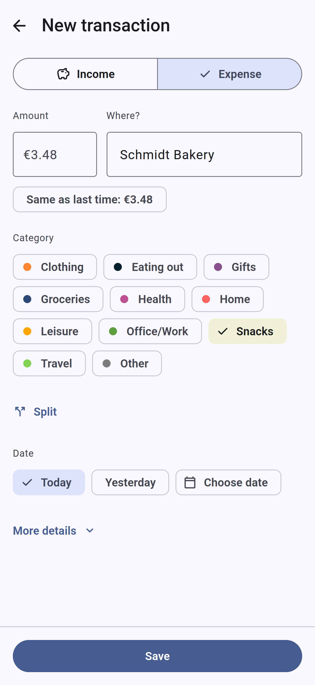
    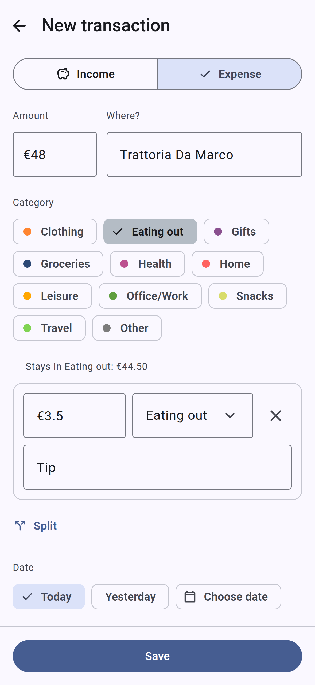
</p>

### Transactions

Transactions grouped by day, with upcoming ones (a bill you already know about) on top. Attached expenses stay with
their main expense, and the list can be filtered by category.

<p>
    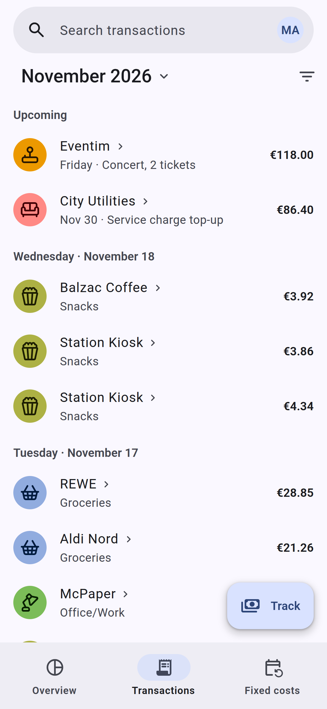
    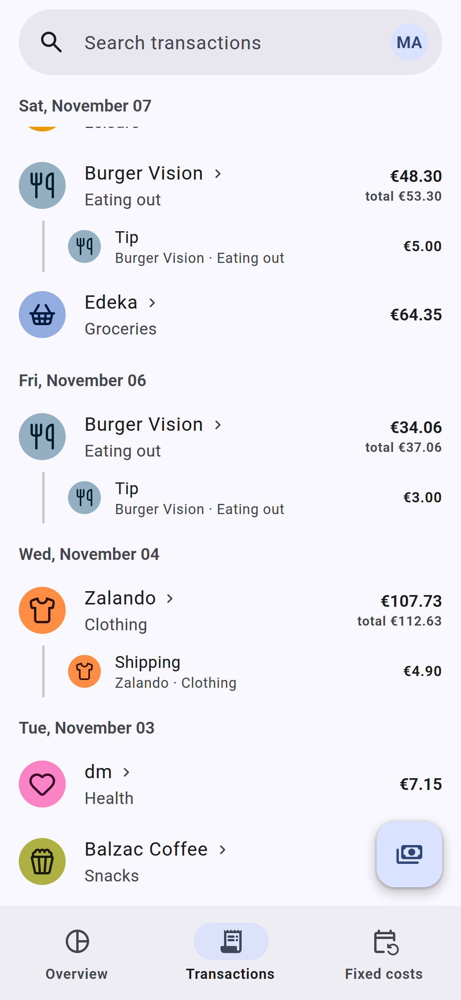
    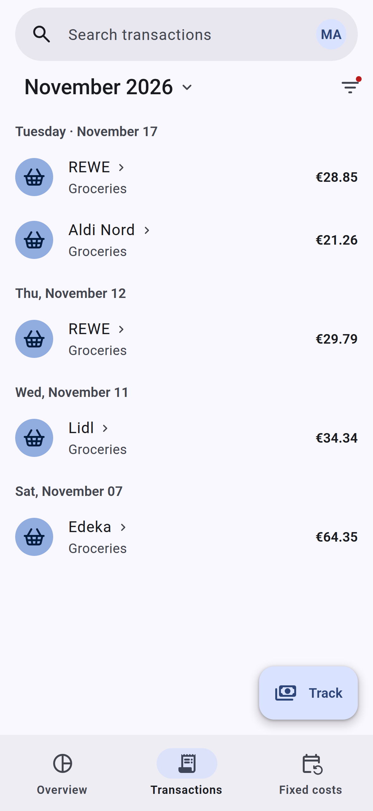
</p>

### Fixed costs

Rent, insurance, subscriptions: monthly, quarterly or yearly, with a start and an optional end date. The app spreads
them over the months, shows their history and a breakdown by kind, and keeps every price change, including announced
ones that are still ahead. Fixed costs can be paused without losing them.

When the same expense comes back at a fixed amount every month, quarter or year, the app offers to turn it into a
fixed cost, prefilled from the next expected charge on.

<p>
    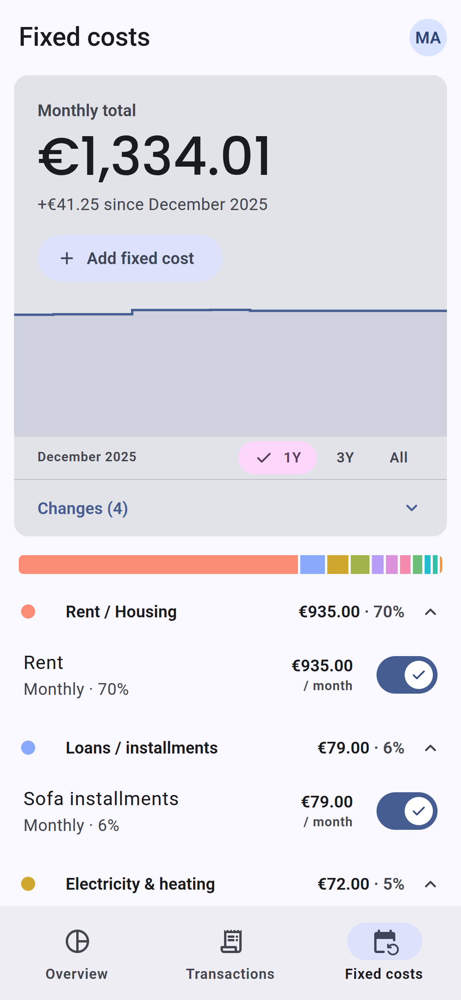
    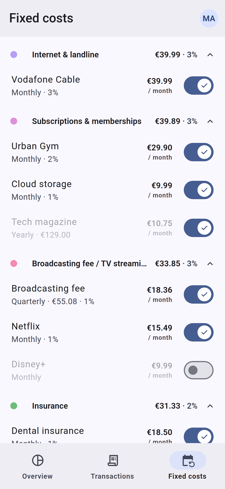
    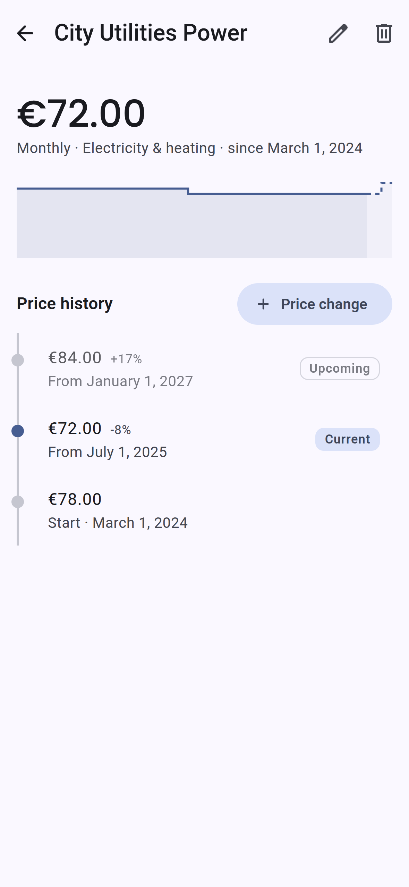
</p>

### Search

Search all transactions by counterparty or description, across months.

<p>
    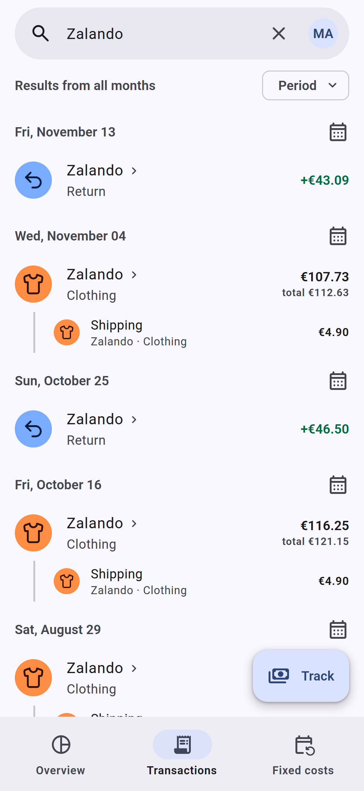
</p>

### Categories and settings

Categories with their own icon and color, separately for expenses and income. In the settings you choose the
language (English or German), export all your data as JSON and import it again.

<p>
    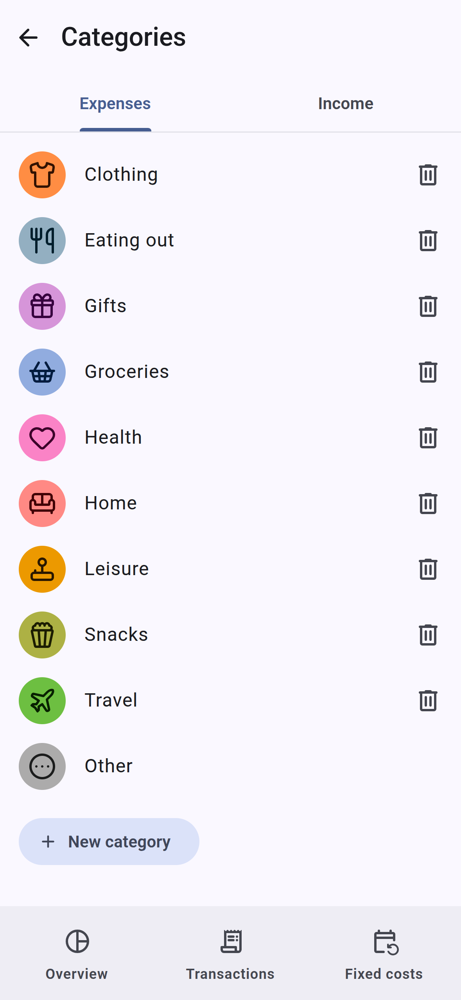
    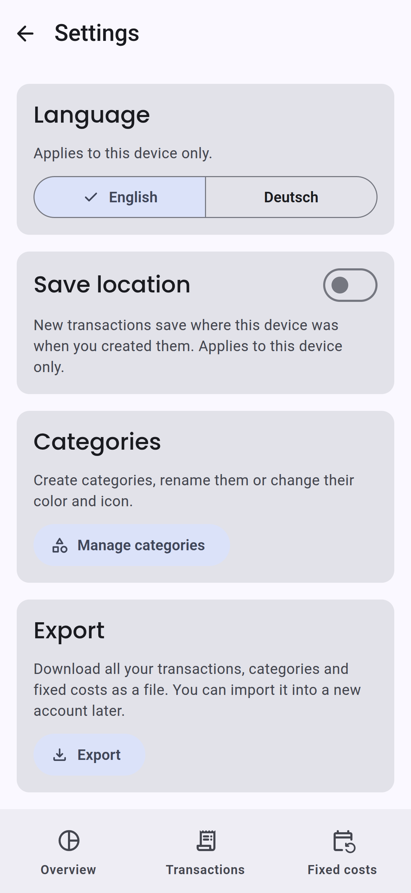
</p>

### Offline and installable

Install the app to your home screen. Without a connection you can keep recording, editing and deleting
transactions; the changes are sent once the device is back online, and nothing the server rejects gets lost.

<p>
    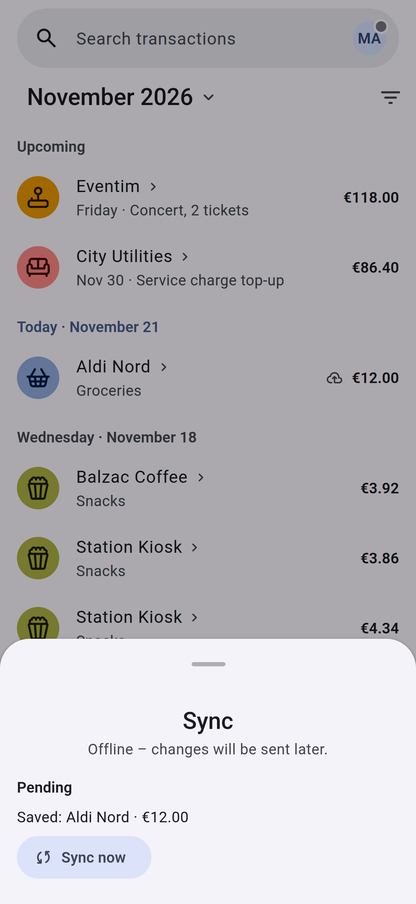
</p>

## Self-hosting with Docker

Pre-built images are published automatically to GHCR on every release: `ghcr.io/jgoedde/finances`. One container serves
both the app and its API; all data lives in a single SQLite database under `/data`. See [Configuration](#configuration)
for the environment variables.

```yaml
services:
    finances:
        image: ghcr.io/jgoedde/finances:latest
        ports:
            - "3000:3000"
        environment:
            # Public URL the app is reached at. Sign-in only works from this origin.
            BASE_URL: https://finances.example.com
            # Generate with: openssl rand -base64 32
            BETTER_AUTH_SECRET: change-me
            # Creates the first admin on the first start (when no users exist).
            ADMIN_USERNAME: admin
            ADMIN_PASSWORD: change-me-too
            # Optional, comma-separated extra origins allowed to sign in.
            # TRUSTED_ORIGINS: http://192.168.1.10:3000
            # Optional: trace, debug, info (default), warn, error, fatal or silent.
            # LOG_LEVEL: info
        volumes:
            - ./data:/data
        restart: unless-stopped
```

The data directory must be writable by the container user (uid 1000): `mkdir data && sudo chown 1000:1000 data`.

Put a TLS-terminating reverse proxy in front of it.

Pin to a specific version instead of `latest` if you want reproducible deploys, e.g. `ghcr.io/jgoedde/finances:2.0.0`.

### Users

There is no public sign-up. Create links with the CLI inside the container and send them to people. Each link works
once; invites expire after 7 days, password reset links after 24 hours.

```bash
docker compose exec finances finances invite
docker compose exec finances finances reset-password <username>
docker compose exec finances finances users
```

### Backup and restore

`finances backup` writes a consistent snapshot of the whole database (all users, accounts and data) to stdout. It is
safe while the server is running. `-T` keeps Docker from mangling the binary output:

```bash
docker compose exec -T finances finances backup > finances-$(date +%F).db
```

`finances restore` reads a snapshot from stdin and replaces the whole database. It only runs on an empty instance (no
transactions or fixed costs yet). To replace an instance that has data, stop the server first and pass `--force`:

```bash
docker compose stop finances
docker compose run --rm -T finances finances restore --force < backup.db
docker compose start finances
```

To move to a new machine:

1. Take a backup on the old machine (see above).
2. On the new machine, set up `compose.yaml` and the data directory as described above. Keep the same
   `BETTER_AUTH_SECRET`, otherwise everyone has to sign in again.
3. Restore before the first start, then start the server. It applies any pending migrations on startup.

```bash
docker compose run --rm -T finances finances restore < backup.db
docker compose up -d
```

### Build from source

```bash
docker build -t finances .
```

## Configuration

In Docker, set the variables under `environment` in `compose.yaml`; for development, copy `apps/api/.env.example` to
`apps/api/.env`.

| Variable                            | Required | Default             | Description                                                                                                                                                                   |
| ----------------------------------- | -------- | ------------------- | ----------------------------------------------------------------------------------------------------------------------------------------------------------------------------- |
| `BASE_URL`                          | Yes      |                     | Public URL of the app. Sign-in only works from this origin, and `https` turns on `Secure` session cookies. In development it's `http://localhost:5173` (the Vite dev server). |
| `BETTER_AUTH_SECRET`                | Yes      |                     | Generate it with `openssl rand -base64 32`. Changing it signs everyone out, so keep it when moving to a new machine.                                                          |
| `ADMIN_USERNAME` / `ADMIN_PASSWORD` | No       |                     | Create the first admin (set both). They are only read on a start with zero users and ignored after that, so you can remove them once the admin exists.                        |
| `TRUSTED_ORIGINS`                   | No       |                     | Comma-separated list of extra origins allowed to sign in, e.g. for `npm run dev:web -- --host` on a phone.                                                                    |
| `LOG_LEVEL`                         | No       | `info`              | One of `trace`, `debug`, `info`, `warn`, `error`, `fatal`, `silent`.                                                                                                          |
| `PORT`                              | No       | `3000`              | Port the server listens on. If you change it, change the compose port mapping too.                                                                                            |
| `DATABASE_PATH`                     | No       | `/data/finances.db` | Path of the SQLite database. In Docker it must be inside the mounted volume.                                                                                                  |

## Tech stack

- Client: React 19, TypeScript, Vite, TanStack Router and Query, Tailwind CSS v4, shadcn/ui styled after Material
  Design 3, Paraglide JS for English and German, installable as a PWA
- API: Hono, better-auth, Kysely and SQLite on Node, typed end to end with Hono RPC
- Shared zod schemas in an npm workspaces monorepo
